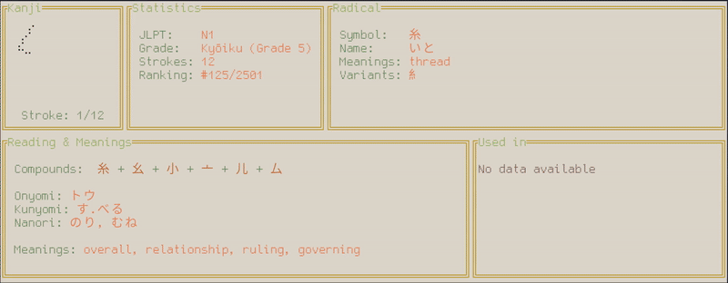

# ⛩️ Kanji TUOI ⛩️

A TUI application to visualize and study Japanese kanji in a cool and compact way, directly inside your terminal.
The app is written completely in **Rust** and uses the **Ratatui** crate for the UI.



## 🌟 Main features

* **Fluid TUI interface:** Fast and reactive navigation, designed to be used with keyboard.
* **Full set of data for each kanji:**: 
    * associated radical
    * onyomi, kunyomi and nanori readings
    * meanings
    * JLPT levels and scholastic grades.
    * and more
* **Dynamic layout:** Two layouts based on the terminal's window size.
* **Two themes:** One inspired by Japanese colors (light) and one based on cyberpunk colors (dark).
* **Light weight and fast:** Written completely in **Rust**.
* **Multi filter search:** Search kanji by multiple criteria.
* **Animated and numbered kanji strokes:** The animation shows each stroke in the correct order.

## ⌨️ Keybindings

The keybindings change depending on whether the search popup is active or not. 
Below is a comprehensive list of all the keybindings:

### View Mode (Active when the search popup is not active)
* **d**: open/close description popup
* **s**: open/close search popup
* **k**: open/close key mapping popup
* **h**: open/close jumps history popup
* **Right Arrow**: next kanji in current search
* **Left Arrow**: previous kanji in current search
* **Up Arrow**: current kanji next stroke
* **Down Arrow**: current kanji previous stroke
* **o**: play strokes animation from the beginning
* **e**: end strokes animation
* **p**: pause/resume strokes animation
* **t**: switch theme (Original/Cyberpunk)
* **b**: switch to pseudo bold mode
* **m**: switch to the next glyph (used for kanji's stroke)
* **q**: quit the app
* **r**: jump to current kanji's radical
* **Tab**: switch between compounds and used-in selection
* **Enter**: jump to the selected compound or used-in item
* **Esc**: close any popup
* **]**: move to the next element of the selection
* **[**: move to the previous element of the selection

### Search Mode (Active when the search popup is open)
* **Space**: [un]toggle selection
* **Enter**: submit filters and start the search
* **Esc**: close search popup
* **>**: switch to radicals search
* **<**: switch to normal search

#### While editing a custom search field:
* **Any alphanumeric key**: type/edit text
* **Esc**: stop editing
* **Tab**: switch to the next editable field
* **Right Arrow**: move the cursor to the right
* **Left Arrow**: move the cursor to the left
* **Backspace**: delete character to the left of the cursor
* **Delete**: delete character to the right of the cursor
* **Enter**: submit filters and start the search

## How to install

You can install `kanji_tuoi` in multiple ways depending on your needs:

### 👑 Recommended

If you want a quick installation without compiling:

* **Using `cargo-binstall`:**
  ```bash
  cargo binstall kanji_tuoi
  ```

### 🦥 For lazy people (No Rust/Cargo required)
If you don't have Rust installed or if you are lazy, you can download the precompiled binary for your system directly from the [Releases](https://github.com/R1KPAP/kanji_tuoi/releases) page:

1. Go to the [Releases](https://github.com/R1KPAP/kanji_tuoi/releases) page.
2. Download the archive (`.tar.gz` or `.zip`) corresponding to your operating system.
3. Extract the executable and place it in a directory included in your system's `PATH` (e.g., `/usr/local/bin/` on Linux/macOS).

### 💻 For Developers & Source Installation
If you want a quick installation without compiling:

* **Directly from Git (Remote):**
  ```bash
  cargo install --git https://github.com/R1KPAP/kanji_tuoi.git
  ```
* **Locally (from cloned repository):**
  Clone the repo, navigate into the folder, and run:
  ```bash
  cargo install --path .
  ```
  To run the data preparation to build the data set run:
  ```bash
  cargo run --bin data_prep --features data_prep --release
  ```

## 📬 Support and Feedback

In case of 🪲 or if you want to share your ideas or feedback
feel free to open an issue at **[Issue](https://github.com/R1KPAP/kanji_tuoi/issues)** on GitHub!

## Acknowledgments & Credits

`kanji_tuoi` is built on top of several fantastic open-source libraries, external projects, and datasets:

### 🦀 Main Rust Crates

* **[Ratatui](https://github.com/ratatui/ratatui)** - The core framework for the terminal user interface.
* **[Crossterm](https://github.com/crossterm-rs/crossterm)** - For cross-platform terminal manipulation.
* **[Serde](https://serde.rs/)** & **[serde_json](https://github.com/serde-rs/json)** - For data serialization.
* **[rayon](https://github.com/rayon-rs/rayon)** - For the dataset encoding used in the app.
* **[usvg](https://crates.io/crates/usvg)** - For parallel streaming, to speed up the data preparation pipeline.
* **[lyon_geom](https://crates.io/crates/lyon_geom/1.0.19)** - For svg curve to line approximation.
* **[wana_kana](https://github.com/PSeitz/wana_kana_rust)** - For conversion to romaji used for the search.
* **[textwrap](https://github.com/mgeisler/textwrap)** - For text wrapping.
* **[anyhow](https://docs.rs/anyhow/latest/anyhow/)** - For error handling and propagation.

### 📚 Datasets & Data Sources

* **[KanjiDIC2](http://www.edrdg.org/wiki/index.php5/KANJIDIC_Project)** - Used for comprehensive kanji dictionary data, meanings, and readings.
* **[KanjiVG](https://kanjivg.tagaini.net/)** - Used for vector stroke data and animation sequences, distributed under the Creative Commons Attribution-ShareAlike (CC BY-SA) license.
* **[Kradfile](http://www.edrdg.org/wiki/index.php5/Kradfile_Info)** - Maintained by the Electronic Dictionary Research and Development Group (EDRDG), used for mapping kanji to their constituent components.
* **[kanjiapi.dev](https://github.com/onlyskin/kanjiapi.dev)** - Used for preprocessed JSON kanji dataset.

## About the name

I'm from 🇮🇹, so I added a little touch of italian 🤌 in the app name, TUOI in Italian means YOURS.
I know it's stupid but I feel that TUI is too impersonal.

## 🔚 Post scriptum

It's my very first project in **Rust** and also my first TUI app, I hope you'll enjoy and have fun with it and that
it doesn't destroy your machine, I'm joking....maybe.

## 📜 License

This project is distributed under the MIT license. See [LICENSE](LICENSE) for details.